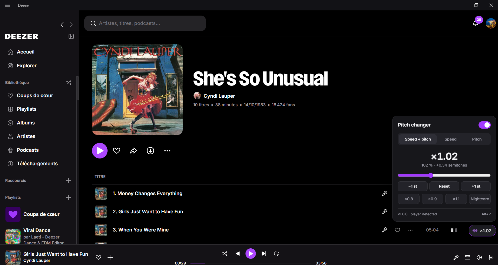

# Deezer Pitch Changer

An unofficial JavaScript plugin that lets you adjust the **speed** and **pitch** of the audio during playback in the **Deezer Desktop app for Windows**.



Three modes:

| Mode | Effect | Engine |
|---|---|---|
| **Speed + pitch** | Like a sped-up / slowed-down vinyl (nightcore, slowed…) | Native `playbackRate`, no pitch correction |
| **Speed** | Faster or slower, same key | Native `playbackRate` + `preservesPitch` (Chromium's time-stretching) |
| **Pitch** | Changes the key, same tempo (−12 to +12 semitones, 432 Hz…) | Pitch-shifting AudioWorklet (phase vocoder) |

## Installation

1. Download **`DeezerPitchChanger.exe`** from the [latest release](https://github.com/valuthringer/deezer-pitch-changer-windows/releases/latest).
2. Double-click it: a small window opens. Click **Apply the patch**. If Deezer is open, it offers to close it, then reopens it once the patch is applied.

> Works with Deezer from [deezer.com/download](https://www.deezer.com/download) and with the **Microsoft Store** version.

> The executable isn't signed: Windows SmartScreen may show "Windows protected your PC". Click **More info** → **Run anyway**.

The executable is **portable**: nothing is installed (no shortcut, no entry in Windows' installed apps, no administrator rights needed), keep it wherever you like. **Nothing runs in the background**: the window offers **Apply the patch** / **Remove the patch**, opens Deezer and checks for updates. It checks GitHub once when it opens; a dot shows when a new version is available, and **Update** replaces the executable with it. The program quits when the window is closed.

- **After a Deezer update** (which removes the patch), open it again and click **Apply the patch**.
- With the **Microsoft Store** version, whose files can't be modified, open Deezer with the **Open Deezer** button of the window: the pitch changer is added each time it starts (a few seconds after it opens).

In Deezer, a **Pitch** button appears at the bottom right (drag it to move it):

- **click** or **Alt+P**: open or close the panel;
- **Alt+Shift+P**: turn the effect on or off;
- **mouse wheel on the slider**: fine adjustment; **double-click**: back to the neutral value;
- **click the value** to type an exact one (`1.024`, `-2.3`, `110 %`, or `3 st` in Speed + pitch mode, up to 3 decimals), then **Enter** to apply or **Esc** to cancel. **↑ / ↓** in the field step the value (**Shift** for fine steps).

Settings are remembered between sessions.

## Uninstall

**Remove the patch** in the window restores the original Deezer, then delete `DeezerPitchChanger.exe`.

Versions up to 1.2 installed themselves (in `%LOCALAPPDATA%\Programs\deezer-pitch-changer`): remove them from **Settings** → **Apps** → **Installed apps** → **Deezer Pitch Changer** → **Uninstall**, which also removes the patch.

## Command line

The executable has no console. For scripts, these commands run without a window:

```
DeezerPitchChanger.exe patch --yes     [--path <Deezer folder>] [--no-launch]
DeezerPitchChanger.exe unpatch --yes   [--path <Deezer folder>] [--no-launch]
DeezerPitchChanger.exe --launch
```

`--yes` closes Deezer if it is open; it is reopened at the end unless `--no-launch` is given. The folder is detected automatically (`%LOCALAPPDATA%\Programs\deezer-desktop` by default). Errors go to the log (see [Development](#development)).

### From the sources

With [Node.js](https://nodejs.org) 18 or newer, `Install.cmd` / `Uninstall.cmd` (or `node src/cli.js install | uninstall | status`) only patch / restore Deezer, in a console: run `Install.cmd` again after each Deezer update.

## How it works

The Deezer app is an Electron shell that displays the `deezer.com` web player.

- **`src/patcher.js`** appends a block to `build/preload.js` inside `resources/app.asar`. It is the only file modified, and a backup `app.asar.pitch-changer-backup` is created.
- **`src/asar.js`** rewrites the archive, replacing only that file. Every other file keeps its bytes and offsets.
- **The block added to the preload** runs **`src/inject/pitch-changer.js`** in the page through `webFrame.executeJavaScript`. That script:
  - finds the player's `<audio>` element;
  - sets `playbackRate` and `preservesPitch`;
  - in Pitch mode, routes the audio through **`src/inject/pitch-worklet.js`**;
  - renders the panel (inside a Shadow DOM, so Deezer's styles are untouched).
- **`src/app.js`** is the entry point of the executable, a [Node.js single executable application](https://nodejs.org/api/single-executable-applications.html) built by **`scripts/build.js`** (no runtime dependencies). It is marked as a GUI app, so no console window opens, and installs nothing. **`src/setup.js`** replaces it in place for updates, and removes what versions up to 1.2 installed.
- **`src/gui.js`** is the window: a local server on `127.0.0.1` (random port, requests checked against a random token) showing **`src/gui.html`** in an Edge app window (Chrome if Edge is missing, otherwise the default browser). The program exits a few seconds after the window is closed. **`src/manager.js`** holds what the window and the shortcuts do (apply or remove the patch, open Deezer, update). **`src/updater.js`** fetches newer versions from the GitHub releases (checked against their size and SHA-256).
- **`src/store.js`** handles the Microsoft Store version (an MSIX package, read-only). When Deezer is opened from the window, the program waits for its main process, asks it to open the Node.js inspector (`process._debugProcess`), registers the same snippet as a preload script of Deezer's sessions, reloads the page if it was already loaded, and closes the inspector again. Nothing is written to Deezer's files.
- **`.github/workflows/release.yml`** builds and tests the executable on every push to `main`, and publishes it as release `v<version>` when the version in `package.json` has none yet.

## Publishing an update

1. Bump `"version"` in `package.json` (`1.0.0` → `1.0.1`, `1.1.0`…).
2. Push (or merge) to `main`.

Pushes to `main` that keep the same version are built and tested but not released, and other branches trigger nothing.
- **The pitch shifter** is a phase vocoder with phase locking around spectral peaks (Laroche & Dolson). Both channels share the same phase rotation, which preserves the stereo image. Latency: about 85 ms. CPU: about 3% of one core.

## Limitations

- With the Microsoft Store version, the button appears a few seconds after Deezer opens (the page reloads once), and only when it is opened from the window. The inspector briefly listens on `127.0.0.1:9229`: if another program uses that port, the pitch changer can't be added (see the log).
- **Pitch** mode has the typical quality of a phase vocoder: very good for small shifts (±3 semitones), more "metallic" beyond that, with slightly softened drum attacks.
- If Deezer changes the structure of its app, the patch may need to be updated.
- The executable embeds the Node.js runtime, hence its size (about 80 MB, downloaded again for each update).

## Development

```
npm install                    # build tools only (postject, rcedit)
npm test                       # pitch shifter, asar patch and bundling tests
npm run build                  # dist\DeezerPitchChanger.exe (Node.js 22 on Windows)
set DZ_DEVTOOLS=yes && "%LOCALAPPDATA%\Programs\deezer-desktop\Deezer.exe"   # Deezer with DevTools
```

`node src/app.js` opens the window from the sources (updating needs the built executable). The executable logs to `%TEMP%\deezer-pitch-changer.log`.

In the DevTools console, `window.__deezerPitchChanger` exposes the current state (settings, tracked audio elements, engine).

## Disclaimer

This is an independent, community-made project and is not affiliated with, endorsed by, or sponsored by Deezer.

This project does not redistribute the Deezer application or its proprietary source code. It only modifies the copy already installed on the user's computer. Users must obtain Deezer through its official channels.

Modifying the Deezer client is not covered by Deezer's terms of use. This project is intended for personal use and is provided as is, without warranty: use it at your own risk.

Deezer is a trademark of its respective owner.
